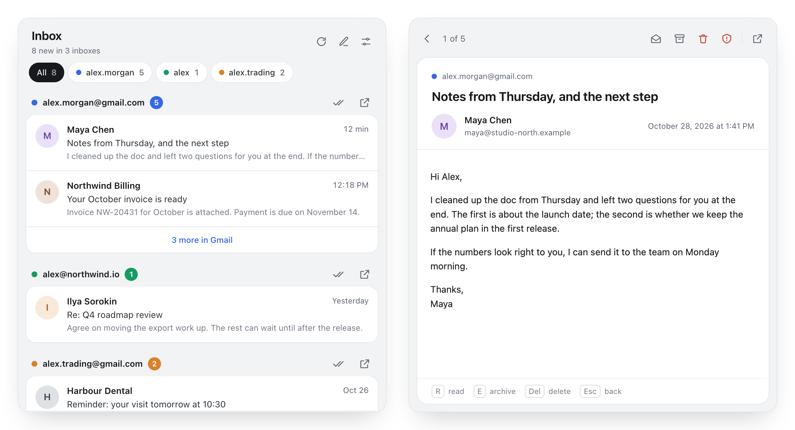
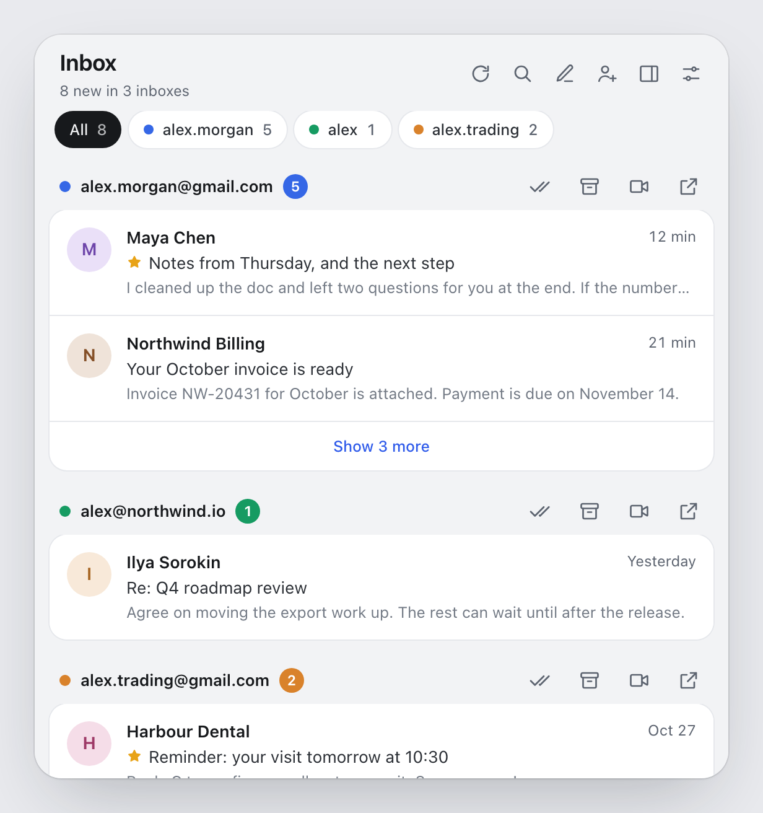
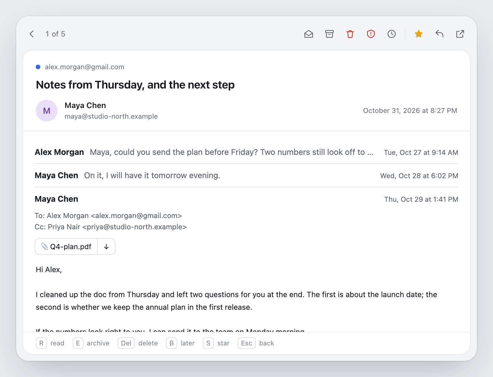
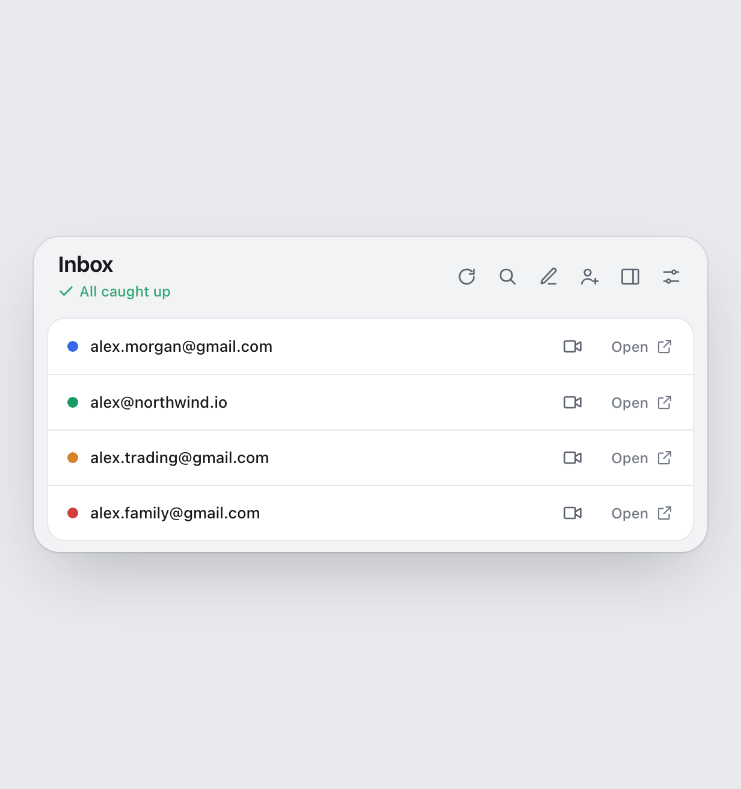
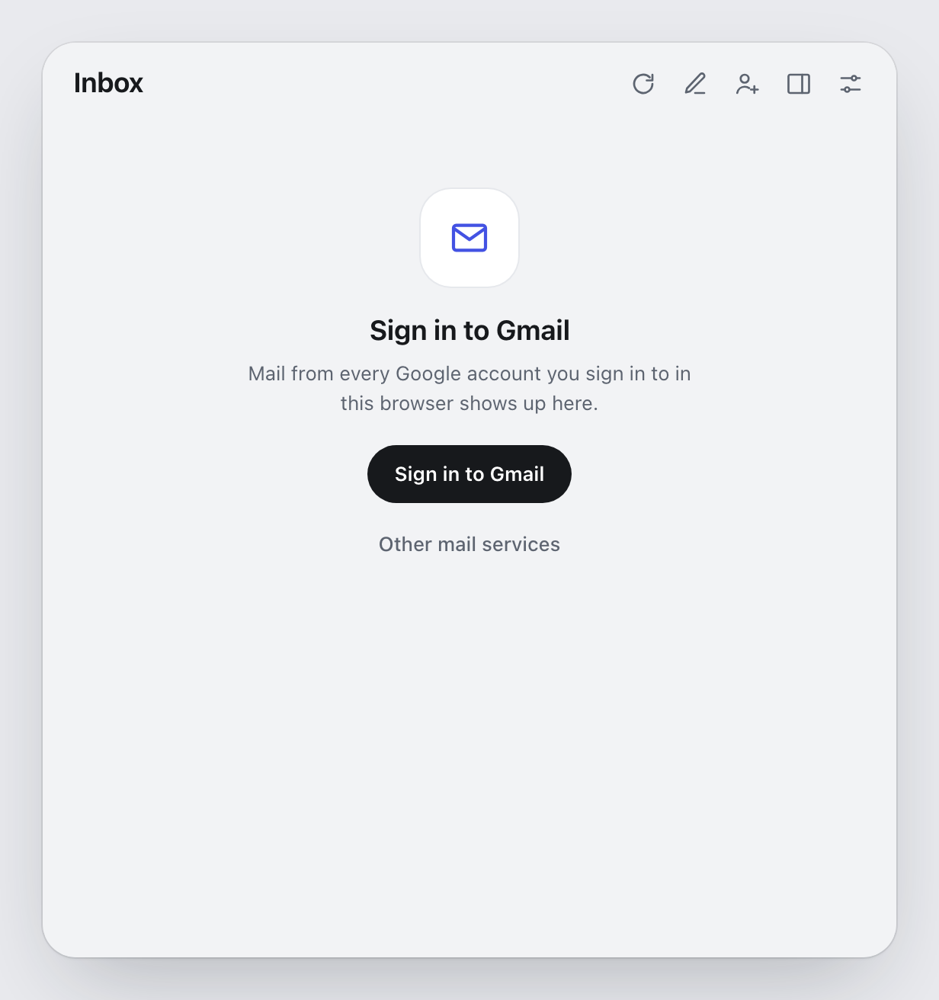
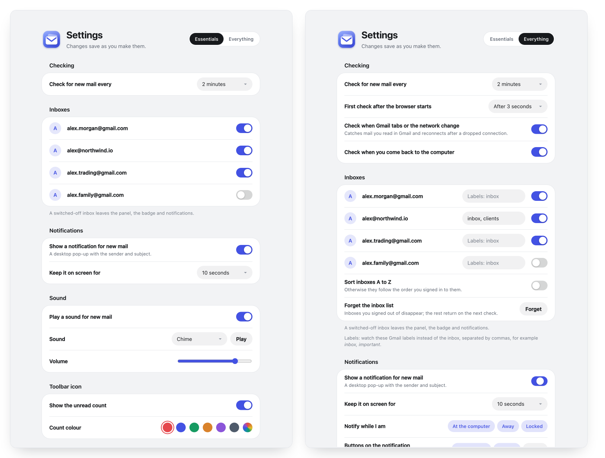

<div align="center">


# Mail Deck for Gmail

**Every Gmail inbox you are signed in to, in one panel.**<br>
Read, archive and delete mail without opening a Gmail tab.

[Website](https://eabychkov.github.io/mail-deck/) · [Features](#features) · [Screens](#screens) · [Install](#install) · [Privacy](PRIVACY.md) · [Development](#development)

<br>

<picture>
  <source media="(prefers-color-scheme: dark)" srcset="docs/images/hero-dark.png">
  
</picture>

</div>

## Features

- **All your inboxes at once.** Each Google account signed in to the browser gets its own colour and unread count. The chips at the top narrow the list to one inbox.
- **Read in place.** Click a message to read the whole conversation in the panel, attachments included. Gmail opens only when you ask it to.
- **Search every inbox.** One search runs in all your Google accounts at once.
- **Later.** Put a message away until this evening, tomorrow or next week; it comes back with a notification.
- **One key per action.** Mark as read, archive, delete or report spam from the list, from the open message or from a notification.
- **Labels.** Watch chosen Gmail labels instead of the inbox, set per account, or only Gmail's Primary tab.
- **Your order.** Drag the inboxes into the order you want. Accounts you signed out of stay listed, one click from signing back in.
- **Meet in one click.** Each mailbox has a button that starts a Google Meet from its account.
- **Notifications and sound.** A desktop notification and an optional sound for new mail. Mute an inbox while it stays in the panel, set quiet hours and a quiet weekend, or notify only for, or never for, chosen senders and subjects.
- **Side panel and keyboard.** Keep the deck open beside the page, or open it with Alt+Shift+M. Text size is yours to set.
- **Backup.** Export your settings to a file, or keep a copy in Chrome sync.
- **Light and dark.** The panel and the settings follow your system theme.
- **Nothing in between.** No servers, no analytics. The extension talks to `mail.google.com` with the session your browser already has, and never sees your password.

## Screens

<table>
  <tr>
    <td width="50%" align="center">
      <picture>
        <source media="(prefers-color-scheme: dark)" srcset="docs/images/inbox-dark.png">
        
      </picture>
      <br><b>Inbox</b><br><sub>One card per account, actions on hover</sub>
    </td>
    <td width="50%" align="center">
      <picture>
        <source media="(prefers-color-scheme: dark)" srcset="docs/images/read-dark.png">
        
      </picture>
      <br><b>Message</b><br><sub>The full text, with every action one click or key away</sub>
    </td>
  </tr>
  <tr>
    <td width="50%" align="center">
      <picture>
        <source media="(prefers-color-scheme: dark)" srcset="docs/images/empty-dark.png">
        
      </picture>
      <br><b>All caught up</b><br><sub>Nothing unread, with a link to every inbox</sub>
    </td>
    <td width="50%" align="center">
      <picture>
        <source media="(prefers-color-scheme: dark)" srcset="docs/images/signin-dark.png">
        
      </picture>
      <br><b>First run</b><br><sub>Sign in to Google and your mail shows up</sub>
    </td>
  </tr>
  <tr>
    <td colspan="2" align="center">
      <picture>
        <source media="(prefers-color-scheme: dark)" srcset="docs/images/settings-dark.png">
        
      </picture>
      <br><b>Settings</b><br><sub>Essentials for every day, Everything when you want to fine-tune</sub>
    </td>
  </tr>
</table>

### Keys

| In the list | In a message | Does |
|---|---|---|
| <kbd>J</kbd> / <kbd>K</kbd> or arrows | | Move between messages |
| <kbd>Enter</kbd> | | Open the message |
| <kbd>R</kbd> | <kbd>R</kbd> | Mark as read |
| <kbd>E</kbd> | <kbd>E</kbd> | Archive |
| <kbd>Delete</kbd> | <kbd>Delete</kbd> | Delete |
| <kbd>!</kbd> | <kbd>!</kbd> | Report spam |
| <kbd>O</kbd> | <kbd>O</kbd> | Open in Gmail |
| <kbd>B</kbd> | <kbd>B</kbd> | Remind me later |
| | <kbd>S</kbd> | Star |
| <kbd>Z</kbd> | <kbd>Z</kbd> | Undo the last action |
| <kbd>/</kbd> | | Search every inbox |
| | <kbd>Esc</kbd> | Back to the list, or out of the search |

The keys go by position, so they work with any keyboard layout.

## Install

**From the [Chrome Web Store](https://chromewebstore.google.com/detail/mail-deck-for-gmail/hjlkjemogfgkpbbnogihekjcdmafecff).**

**From source** (Chrome, Brave, Edge, any Chromium browser):

1. Download this repository and unzip it.
2. Open `chrome://extensions` and turn on **Developer mode**.
3. Click **Load unpacked** and pick the `extension` folder.
4. Sign in to Gmail in the same browser. The envelope on the toolbar shows your unread count.

## Development

```
extension/            the extension (load this folder unpacked)
  manifest.json
  core/               background: checking feeds, badge, notifications, actions
  data/panel/         the toolbar panel
  data/settings/      the settings page
  _locales/           translations
store/                Chrome Web Store listing text and images
tools/build-icons.sh  renders the icons from tools/icons.html
tools/package.sh      zips the extension for the store into dist/
tools/publish.py      uploads that zip to the Chrome Web Store and submits it for review
docs/images/          the pictures in this README
```

Mail comes from Gmail's Atom feed of each signed-in account, the full text from the message's print view, and actions go to `mail.google.com` the way the Gmail page sends them. There is no build step: edit a file, then reload the extension on `chrome://extensions`.

Package for the store:

```sh
tools/package.sh      # dist/mail-deck-<version>.zip
```

## License

[Mozilla Public License 1.1](LICENSE). Mail Deck grew out of Notifier for Gmail by InBasic; see [NOTICE.md](extension/NOTICE.md).

Mail Deck is not made by or affiliated with Google. Gmail is a trademark of Google LLC.
